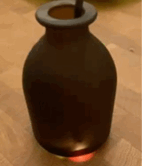
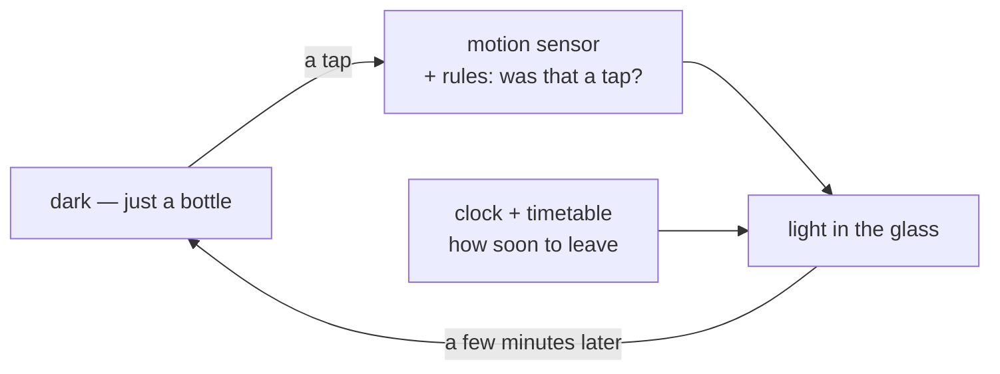

# eki-bin 駅瓶

> An ambient train-departure display.

  

## What it is

A glass bottle that sits on a table and, most of the time, is just a bottle.
Tap it and it lights up from inside, showing how soon you need to leave for
the next trains, each line in its own colour. Tilt it to make it brighter or
dimmer. A few minutes later it goes dark again. There's no screen, no app,
and no network.

**eki-bin** (駅瓶, "station bottle") is a play on *ekiben* (駅弁), the
station bento.

## Why it exists

It's a deliberate trip into the wilderness: no app, no Bluetooth, no WiFi,
chosen the way you might choose to go camping, for the intrinsic joy of
doing without. The question is what an intelligent clock would look like if
it were built from first principles in a world parallel to ours, one with no
smartphones and no wireless signal in every room.

The answer it reaches for is *monozukuri* (ものづくり), the Japanese tradition
of craftsmanship in making things. Where most products today are
*software-defined*, eki-bin tries to be monozukuri-defined: the object comes
first, and the hardware, the software and, as it grows, machine learning
serve it. Everything runs offline, inside the bottle, and is engineered to
disappear, so that what's left looks entirely ordinary.

That also means the interactions come from bottles rather than from phones.
People have tapped, tilted, poured and looked into vessels for as long as
there have been vessels; nobody has ever pinched one to zoom. And it means
the light is an indicator, not a display. It's there when you ask, and
dark the rest of the time. Unlit, it should still be a bottle worth having
on the table.

v1.7 is one step on a long road: not the beginning of the story, and not
the end of it.

## How it works

A real-time clock and a timetable on the device say how long until you need
to leave. A motion sensor listens for a tap or a tilt, and a small set of
rules decides whether a tap was really a tap and not a hand picking the
bottle up. Today those rules are hand-built and measured on recordings. Where
they fall short, the next step is a tiny on-device model, such as a decision
tree running on the motion sensor's own machine-learning core. Details:
[the display pipeline](docs/contracts/display-contract.md) and
[the input pipeline](docs/imu-interaction-plan.md).

## Where it is now

**v1.7: one bottle, lived with day to day.** A XIAO RP2350, a DS3231
real-time clock, an LSM6DSV16X motion sensor and a strip of 21 LEDs inside
thick brown glass, powered over USB. The firmware is MicroPython, with 600+
tests run before every upload.

Tap to wake and change line, tilt for brightness, day/night brightness, and
goodnight and morning ceremonies are all in the firmware on the bottle. A rebuilt input pipeline, which
stops a tap and a tilt from being mistaken for each other, works in
simulation on recorded data and is next to go onto the bottle.
What changed, and why: [release notes](docs/releases/v1.7.md).

## What we've learned

- **The glass decides the design.** Thick glass makes beautiful refractions
  and hides the inside, but the bottles people bring, wanting it in *theirs*,
  are mostly lighter and thinner, and they show it. That moved the project
  from hidden LEDs toward light that's visible and dressed to be seen.
- **Everything goes in through a 22 mm neck.** The bottle was, literally,
  the bottleneck: every part and every iteration had to fit through it.
- **A bottle in a hand is hard physics.** The first moment of a grab can
  look just like a tap; what tells them apart arrives later.
- **Battery, or a lamp?** Battery power is possible, but if the object
  becomes a light, power from above dissolves the problem instead of
  solving it.

More, with the measurements: [v1.7 learnings](docs/releases/v1.7-learnings.md).

## Read further

| | |
|---|---|
| [Concept](docs/concept.md) · [principles](docs/design-principles.md) | why it's built this way |
| [Build one](docs/provisioning-runbook.md) · [wiring](pinouts/) | from a bare board to a running bottle |
| [Display](docs/contracts/display-contract.md) · [light language](docs/contracts/light-language.md) | how time becomes light, and how the light moves |
| [Input](docs/imu-interaction-plan.md) | tap and tilt: recording, simulation, the arbiter |
| [Tuning](docs/contracts/config.md) | every setting, from brightness to colour schemes |
| [Schedules](docs/contracts/schedule-json.md) · [privacy](docs/security.md) | timetables, and keeping a commute private in a public repo |
| [Development](docs/development.md) | `make` targets and workflows |
| [Field notes](docs/insights.md) | the why behind decisions, as they were made |
| [Roadmap](docs/roadmap.md) · [the chandelier](docs/chandelier-concept.md) · [status](dev-status.md) | what's next, and where it might go |

---

MIT licensed. Developed with [Claude Code](https://claude.com/claude-code);
[`CLAUDE.md`](CLAUDE.md) is its brief.
